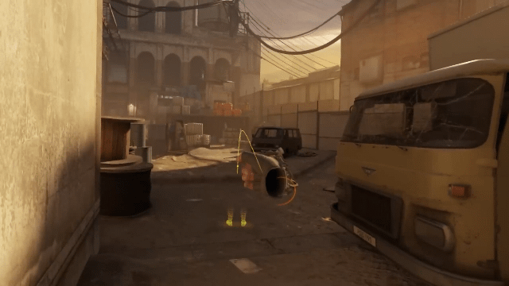

# Half-Life Alyx FTP Patch

<p align="center">
  
</p>

Brings back **Fast Teleport (FTP)** in Half-Life: Alyx for Quest headsets after
the May 2022 fix. Use FTP with current, supported SteamVR versions without
installing an archived SteamVR build.

The patch applies only to **Half-Life: Alyx**.

## Installation

Requires **Windows x64**, Half-Life: Alyx and SteamVR.

1. [Download **hla-ftp-patch-windows-x64.zip**](https://github.com/prolert/hla-ftp-patch/releases/latest).
2. Extract the archive into a separate folder.
3. Close Half-Life: Alyx.
4. Run **`install.bat`** from the extracted folder.
5. Start SteamVR and Half-Life: Alyx.

Keep all extracted files together. Use the ready-to-install ZIP from
**Releases**; GitHub's **Code → Download ZIP** contains source code.

## Controller binding

Open the SteamVR controller bindings for **Half-Life: Alyx**.

1. Under **Move**, assign **Jump** (`/actions/move/in/ShiftDashJump`) to **Grip**.
2. Select **Use as Button**.
3. Set **Click Activation Threshold = 50** and **Click Deactivation Threshold = 100**.
4. Save the binding, then hold the button you assigned in-game. That's it!

**P.S.** Hold Grip between **50% and just under 100%** (`0.5 <= grip < 1.0`).
Within this range, the restored input logic alternates between pressed and
released. Squeezing fully to exactly **100%** stops the repetition.

## Uninstall

Close Alyx and run **`uninstall.bat`** from the extracted folder. It restores
your saved original DLL.

## Updates

- SteamVR updates are handled automatically on each Alyx launch while the
  expected code pattern remains recognizable.
- If Valve changes that code substantially, an updated patch may be needed.
- An Alyx update or Steam file verification may remove the patch. Run
  `install.bat` again afterward.

## Troubleshooting

**Game not found?** Run the installer with your Alyx folder:

```powershell
.\install.bat -GamePath "D:\SteamLibrary\steamapps\common\Half-Life Alyx"
```

**FTP not working?** Recheck the binding and avoid squeezing Grip all the way.
The diagnostic log is `game\bin\win64\hla_ftp.log` inside the Alyx folder.
You can also run `ftp_check.exe` to check SteamVR compatibility without changing
any files.

**Missing original DLL?** Use Steam's **Verify integrity of game files**, then
reinstall the patch. Keep `openvr_api_ftp_original.dll` beside the installed
proxy. Compatibility with other OpenVR proxies is not guaranteed.

## More information

- [How it works](docs/HOW_IT_WORKS.md)
- [Testing and supported scope](docs/TESTING.md)
- [Contributing and building from source](CONTRIBUTING.md)
- [Changelog](CHANGELOG.md)

## Acknowledgements

Made with Codex.

[MIT License](LICENSE).
